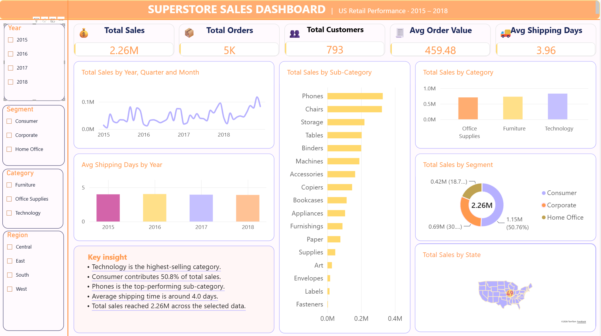

# Superstore Sales Performance Dashboard

A Power BI portfolio project analyzing U.S. retail sales from 2015 to 2018. The dashboard summarizes sales trends, product categories, customer segments, geography, and shipping time.

> The dataset describes a fictional retail business. Its customer names and transactions are sample data, not evidence about a real company.

## Business question

How do sales vary over time, across product categories and customer segments, between U.S. regions, and by shipping duration?

## Tools

- Power BI
- Power Query
- DAX
- CSV data

The supplied presentation describes a workflow involving data preparation, a star schema, DAX measures, and an interactive Power BI dashboard. The available Power BI project file is only a 299-byte PBIP manifest that points to a missing `SalesDashboard_Rawan.Report` folder. I could not inspect the model, DAX definitions, or report pages directly, so those implementation details are reported as described in the supplied presentations, not independently verified from a runnable Power BI project.

## Dataset

- Source: [Sales Forecasting dataset on Kaggle](https://www.kaggle.com/datasets/rohitsahoo/sales-forecasting)
- Local file: `data/raw/sales_forecasting_train.csv`
- 9,800 order-line rows and 18 columns
- Order dates: 2015-01-03 through 2018-12-30
- 4,922 distinct orders and 793 distinct customers
- 11 missing Postal Code values; no exact duplicate rows
- The dataset contains Sales but not Profit, Quantity, or Discount fields. This project therefore does not report profit, units sold, or discount effectiveness.

The project owner confirmed that the dataset license permits redistribution. Consult the Kaggle source page for the publisher's license and attribution terms.

## Dashboard features

The supplied dashboard screenshot shows KPI cards for sales, orders, customers, average order value, and average shipping days. It also shows sales by time, category, sub-category, customer segment, and state, with slicers for year, segment, category, and region.

## Verified findings

Calculated from the provided CSV:

- Total sales: **$2,261,536.78**
- Average order value: **$459.48**
- Average shipping duration: **3.96 days**
- Technology is the highest-sales category at **$827,455.87**.
- Consumer customers account for **50.76%** of sales.
- The West is the highest-sales region at **$710,219.68**.
- Phones is the highest-sales sub-category at **$327,782.45**.
- Annual sales fell from **$479,856.21** in 2015 to **$459,436.01** in 2016, then rose to **$600,192.55** in 2017 and **$722,052.02** in 2018.

Sales totals describe line-item revenue in the supplied file. Average order value is total sales divided by distinct Order ID. Shipping days are calculated as Ship Date minus Order Date and averaged across rows.

## Project files

- `data/raw/sales_forecasting_train.csv` — supplied source data
- `assets/dashboard-preview.png` — dashboard screenshot
- `assets/dashboard-cover.png` — presentation cover artwork
- `presentations/superstore-sales-performance-case-study.pptx` — refined portfolio presentation
- `presentations/sales-performance-dashboard.pptx` — additional supplied presentation

The supplied `.pbip` manifest is not included because the report folder it references was not provided. A runnable PBIX or the complete `SalesDashboard_Rawan.Report` folder is needed to inspect and share the interactive report itself.

## How to explore

1. Start with the dashboard preview in `assets/`.
2. Review the portfolio presentation in `presentations/` for the project narrative and stated workflow.
3. Load the CSV into Power BI Desktop to reproduce or extend the visible sales analysis.

## My contribution

**Individual project.** The repository documents the dashboard and analysis prepared for this portfolio project. The supplied materials do not include a runnable Power BI report, so report internals and DAX measures could not be independently checked.
